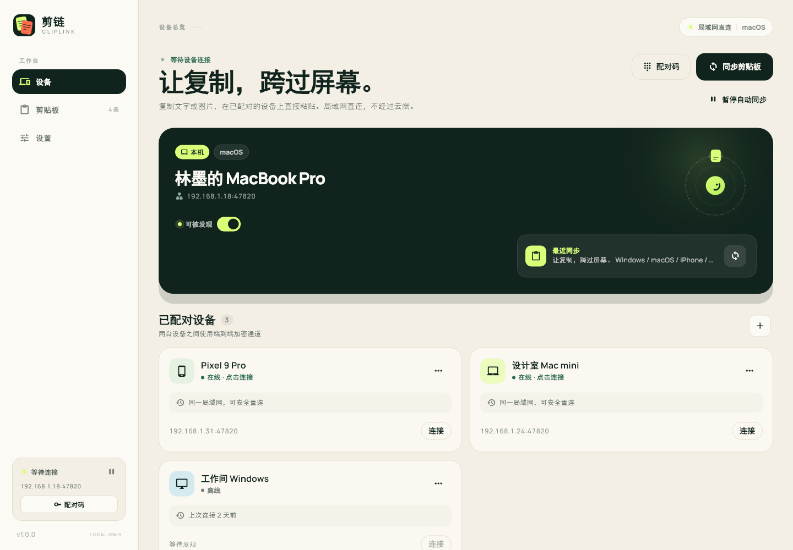
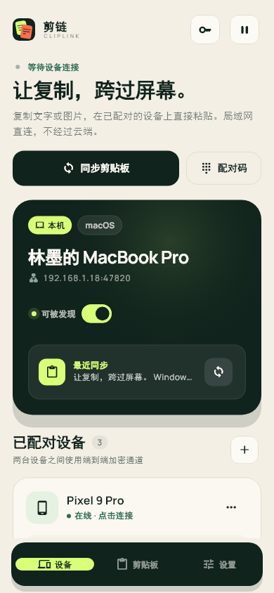
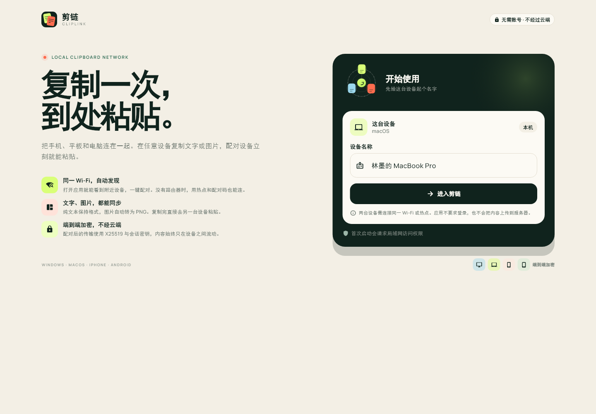
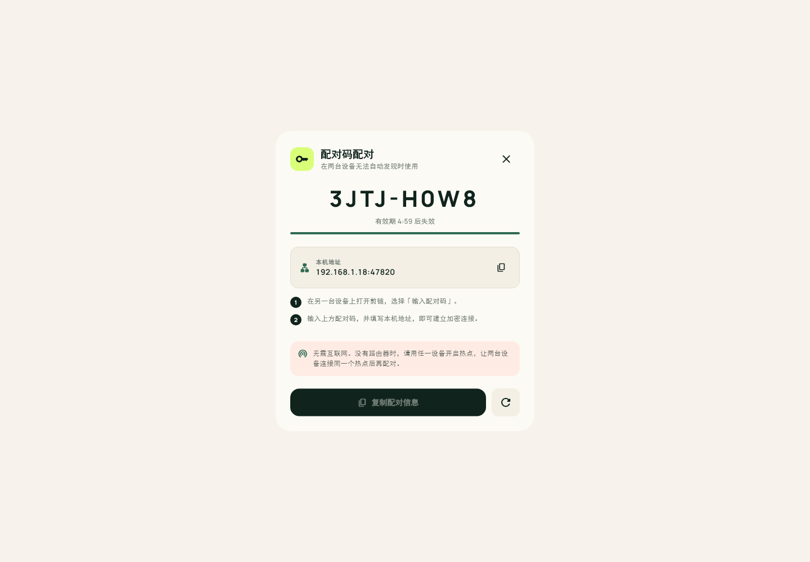
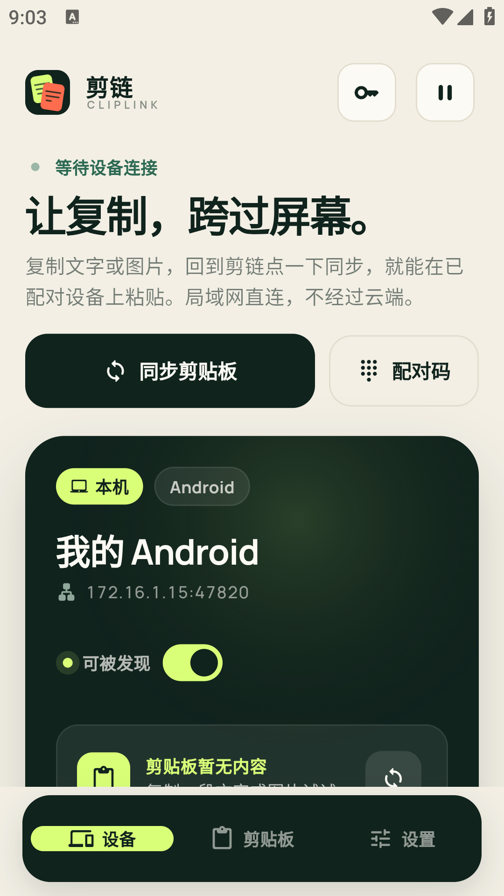

# 剪链 ClipLink

[](https://github.com/yxiao055/cliplink/actions/workflows/build-release.yml)

> 复制一次，跨过屏幕。  
> 一款局域网直连、跨 Windows / macOS / iPhone / Android 的文本与图片剪贴板工具。

GitHub: [yxiao055/cliplink](https://github.com/yxiao055/cliplink) · [下载构建产物](https://github.com/yxiao055/cliplink/actions/workflows/build-release.yml) · [Releases](https://github.com/yxiao055/cliplink/releases)



剪链让同一局域网中的设备互相发现、配对，并把一台设备复制的**纯文本或图片**同步到已配对设备的系统剪贴板。内容只在设备之间直接传输，不经过云端，也不需要登录。

## 已实现功能

- **局域网自动发现**：UDP 广播 + 组播自动发现附近设备，无需输入 IP。
- **两种配对方式**
  - 附近设备一键配对，双方核对 6 位验证码。
  - 无法自动发现时，生成 8 位一次性配对码；另一台设备输入配对码和本机地址。
- **文本 + 图片剪贴板同步**
  - 文本保留换行与空格。
  - 图片统一转为 PNG，最大 20 MB。
  - 接收端自动写入系统剪贴板，直接可以粘贴。
- **端到端加密连接**
  - X25519 临时密钥交换、HKDF-SHA256 派生会话密钥。
  - AES-256-GCM 加密所有同步内容。
  - 配对时使用验证码 / 配对码认证，重连时使用保存在本机的 256 位配对密钥做 HMAC 挑战。
- **自动重连**：已配对设备在同一网络重新出现后自动建立加密连接。
- **剪贴板历史**：本机保存最近 40 条文本和图片，可再次复制或发送。
- **同步暂停**：临时暂停发送和接收，连接保持在线。
- **四端适配**：Windows、macOS、iOS、Android 共用一套 Flutter 代码和网络协议。
- **中文界面、深/浅色视觉统一、响应式布局**。

| 手机端 | 首次启动 | 配对码 |
| --- | --- | --- |
|  |  |  |

## 从 GitHub 下载安装包

每次推送、Pull Request 或手动触发，GitHub Actions 会并行构建四个平台：

- [Actions 构建记录与 Artifacts](https://github.com/yxiao055/cliplink/actions/workflows/build-release.yml)
- [GitHub Releases](https://github.com/yxiao055/cliplink/releases)

| 平台 | 产物 | 说明 |
| --- | --- | --- |
| Windows x64 | `ClipLink-Windows-x64.zip` | 便携版，解压即用；未签名 |
| Android | `ClipLink-Android-universal.apk` | arm64-v8a / armeabi-v7a / x86_64，测试签名 |
| macOS | `ClipLink-macOS-*-unsigned.zip` | GitHub 构建机架构；未签名 |
| iOS | `ClipLink-iOS-unsigned.ipa` | 未签名，需要用自己的 Apple 开发者证书重签 |

推送 `v*` 标签（例如 `v1.0.0`）时，Release 任务会把四个安装包自动附加到 GitHub Release。

> Windows/macOS 未做商业代码签名，可能触发 SmartScreen/Gatekeeper 提示。iOS 未签名 IPA 不能直接安装，需要用 Xcode、Sideloadly 或自己的签名服务重签。

## 快速开始

### Windows

1. 从 Release 或 Actions Artifacts 下载 `ClipLink-Windows-x64.zip`，完整解压后运行 `cliplink.exe`。
2. 首次运行 Windows 防火墙会询问网络权限，请允许**专用网络**。
3. 在另一台设备上安装/打开剪链，连接**同一个 Wi-Fi**。
4. 两台设备会自动出现在「附近设备」，点击「配对」。
5. 双方核对相同的 6 位验证码，接受后即可复制粘贴。

### Android

下载 `ClipLink-Android-universal.apk` 安装：



- 支持 `arm64-v8a`、`armeabi-v7a`、`x86_64`；
- 已包含 `libirondash_engine_context_native.so` 与 `libsuper_native_extensions.so` 三个 ABI 版本；
- 已在雷电模拟器 9（Android 9 / x86_64）实际启动验证；
- 当前使用 debug keystore 签名（可直接侧载测试，上架前请替换签名）；
- 安装时允许浏览器/文件管理器「安装未知应用」；如果覆盖安装失败，请先卸载旧版本。

从源码构建：

```bash
flutter pub get
python scripts/android_gradle9_compat.py   # 修复旧版 CargoKit 与 Gradle 9 的兼容问题
flutter build apk --release
```

### iOS / macOS

GitHub Actions 会构建 **未签名** 的 macOS `.app` 压缩包和 iOS `.ipa`。本地构建：

```bash
flutter build macos --release                       # macOS，输出 .app
flutter build ios --release --no-codesign           # iOS 未签名 .app
# 如需安装到 iPhone，需要用 Xcode/开发者证书重签
flutter build ipa --release                         # 有签名配置时
```

平台的本地网络权限、Android 剪贴板 Provider、macOS 网络 entitlements 已配置好。具体见[构建与平台说明](docs/PLATFORM.md)。

### 没有路由器时怎么配对

剪链不需要互联网，但两台设备之间必须存在一个局域网。没有路由器时：

1. 用任一设备开启热点：
   - iPhone：设置 → 个人热点；
   - Android：设置 → 热点和网络共享；
   - Windows：设置 → 网络和 Internet → 移动热点。
2. 让另一台设备连接该热点。
3. 在剪链首页点「配对码」，对方点「配对码」并输入：
   - 本机地址（如 `192.168.137.1:47820`）；
   - 8 位配对码。
4. 配对码 5 分钟有效且只能使用一次。

> 完全没有 Wi-Fi、热点或数据网络时，设备之间没有传输通道，剪链无法凭空同步。当前版本没有使用蓝牙作为后备通道。

## 使用说明

### 配对流程

- **附近设备配对**
  1. 两台设备都打开剪链并连接同一局域网；
  2. 发起方点「配对」；
  3. 发起方显示验证码，接收方收到配对请求弹窗；
  4. 双方核对验证码一致后，接收方点「允许配对」；
  5. 配对完成，之后会自动重连。
- **配对码配对**
  1. 接收方点「配对码」生成一次性配对码，并显示本机地址；
  2. 发起方点「配对码」，填写地址和配对码；
  3. 校验通过后即建立加密连接。

配对密钥只保存在各自设备本地，不需要服务器参与。

### 剪贴板与图片

- 桌面端在应用运行期间会持续监听剪贴板。
- 收到远程内容后，剪链会直接写入本机系统剪贴板，在任意应用中粘贴即可。
- 图片最大 20 MB，超大图片会被跳过并提示。
- 同步暂停时，仍然会保留本机剪贴板历史，但不会发送/接收。

## 平台限制（重要）

剪贴板是受操作系统严格保护的隐私数据，四个平台的限制不同：

| 平台 | 自动监听 | 收到内容自动写入剪贴板 | 说明 |
| --- | --- | --- | --- |
| Windows | 应用运行期间可后台监听 | 支持 | 首次需允许防火墙专用网络 |
| macOS | 应用运行期间可后台监听 | 支持 | 首次需允许本地网络；已配置 network entitlements |
| Android | 仅应用前台 | 支持（应用运行时） | Android 10+ 禁止普通后台应用读取剪贴板 |
| iOS | 默认关闭，手动同步 | 支持 | iOS 会在读取剪贴板时弹系统粘贴确认，后台无法监听 |

因此手机端的典型用法是：

> 在聊天软件里复制 → 回到剪链 → 点「同步剪贴板」→ 在电脑上粘贴。

iOS 建议保持「自动监听剪贴板」关闭并使用首页/设置里的「同步剪贴板」按钮，避免反复出现系统粘贴确认。剪链无法绕过这些系统限制。

其他限制：

- 两台设备必须处于同一局域网/热点中；企业 Wi-Fi 的 AP 隔离、访客网络和防火墙会阻断发现和连接。
- 设备锁屏、应用被系统挂起或退出后，实时同步可能中断；回到应用后会自动重连。
- 仅同步纯文本和图片，不同步富文本格式、文件、链接卡片或剪贴板中的多个条目。
- 需要在同一子网内直连；不支持跨互联网/跨 NAT 中继。

## 安全设计

| 项目 | 方案 |
| --- | --- |
| 身份 | 每台设备 128 位随机 device ID |
| 配对码 | 8 位 Crockford Base32（40 bit），5 分钟过期，一次性 |
| 发现 | UDP `47821` 广播/组播，只包含设备名、ID、地址、端口，不包含剪贴板内容 |
| 自动配对 | 双方核对 6 位 SAS（基于握手 transcript 的哈希） |
| 密钥交换 | 每次连接生成新的 X25519 临时密钥对 |
| 密钥派生 | HKDF-SHA256（以 transcript 哈希为 salt） |
| 传输加密 | AES-256-GCM，双向独立密钥与 nonce 前缀，单调计数器 |
| 重连认证 | 保存的 256 位配对密钥 + HMAC-SHA256 双向校验 |
| 完整性 | 每个剪贴板帧带 SHA-256 内容哈希并由 AEAD 认证 |
| 云端 | 无任何云端服务、账号或遥测上传 |

配对密钥保存在系统应用支持目录的 `peers.json` 中（由操作系统用户目录权限保护）。如果设备磁盘被完全攻破，攻击者可以读取配对密钥；对高敏感环境建议开启全盘加密。

验证码/配对码用于让用户确认对端身份。不要在不信任的公共 Wi-Fi 上接受来源不明的配对请求。

更完整的包格式、握手字段和密钥派生说明见 [协议文档](docs/PROTOCOL.md)。

## 技术架构

```text
┌────────────┐       UDP broadcast / multicast (47821)       ┌────────────┐
│  Device A  │ ◄───────────────────────────────────────────► │  Device B  │
│            │                                               │            │
│ Discovery  │       TLS-like encrypted TCP (47820+)          │ Discovery  │
│ PeerServer │ ◄───────────────────────────────────────────► │ PeerClient │
│ Clipboard  │      JSON control + binary clip frames         │ Clipboard  │
└────────────┘                                               └────────────┘
```

- `lib/network/discovery_service.dart`：UDP 发现、组播、Android MulticastLock 桥接。
- `lib/network/peer_connection.dart`：配对握手、HMAC 认证、加密帧、剪贴板传输。
- `lib/network/peer_server.dart`：TCP 监听与连接生命周期。
- `lib/core/crypto.dart`：X25519、HKDF、SAS、配对码证明、AES-GCM 通道。
- `lib/services/clipboard_service.dart`：通过 `super_clipboard` 读写文本/PNG 图片。
- `lib/app_controller.dart`：发现、连接、同步、历史、设置与配对状态编排。
- `lib/ui/`：响应式桌面侧栏/移动底栏、设备、历史、设置、配对弹窗。

没有自建中继服务器；所有传输都在同一局域网内点对点完成。

## 开发与构建

### GitHub Actions 自动构建

工作流文件：[`.github/workflows/build-release.yml`](.github/workflows/build-release.yml)

- **Windows x64**：`windows-latest` → `flutter build windows --release` → ZIP
- **Android**：`ubuntu-latest` + JDK 17 + NDK 28.2 → 应用 CargoKit/Gradle 9 兼容补丁 → APK → 校验三个 ABI 的原生库
- **macOS**：`macos-latest` → 未签名 `.app` → ZIP
- **iOS**：`macos-latest` → `flutter build ios --release --no-codesign` → 未签名 IPA
- **Release**：推送 `v*` 标签时，下载全部 Artifacts 并创建 GitHub Release

本地/真机签名说明见 [docs/PLATFORM.md](docs/PLATFORM.md)。

### 环境

- Flutter 3.50.1 / Dart 3.14（推荐 stable）
- Windows：Visual Studio 2022 Desktop development with C++ + Windows 10/11 SDK
- macOS/iOS：Xcode 16+、CocoaPods
- Android：Android SDK（最低 Android 7.0 / API 24，编译 API 36）、NDK 28.2.13676358（`super_clipboard` 需要）
- 首次构建 `super_clipboard` 会下载/构建对应的原生库；Android 建议通过 SDK Manager 安装 NDK

> Windows 上 Flutter 需要开发者模式才能创建插件符号链接；这是 Flutter 工具链的要求，不是剪链运行时的要求。发布后的 exe 不需要 Flutter。

### 命令

```bash
flutter pub get
flutter analyze
flutter test
flutter run -d windows
flutter run -d macos
flutter run -d android
flutter run -d ios
```

构建发布包：

```bash
flutter build windows --release   # build/windows/x64/runner/Release
flutter build macos --release     # build/macos/Build/Products/Release
flutter build ipa --release       # 需要 Xcode 签名

# Android：先应用旧版 CargoKit 的 Gradle 9 兼容补丁
python scripts/android_gradle9_compat.py
flutter build apk --release
```

Android release 目前在模板中使用 debug 签名，正式上架前请替换为自己的签名配置；iOS 需要在 Xcode 中配置 Team 和 Bundle ID。详见[平台与构建说明](docs/PLATFORM.md)。

### 图标

源图在 `assets/branding/`：

```bash
python scripts/generate_icons.py
dart run flutter_launcher_icons
```

### 测试

```bash
flutter test
```

测试覆盖：

- 配对码格式、归一化与一次性语义；
- X25519 双方密钥/SAS 一致性；
- 配对码证明、角色绑定的 HMAC 证明；
- AES-GCM 加解密和篡改拒绝；
- 真实 loopback TCP 上的配对、SAS 校验、文本双向传输、图片双向传输；
- 配对码连接、配对密钥重连认证、错误配对码拒绝；
- UI 离屏渲染截图（Windows 上生成到 `build/previews/`）。

当前环境验证结果：

- `flutter analyze` 无问题；
- 12 个协议/网络测试全部通过（局域网发现、配对码、SAS、加密通道、双向文本/图片、重连认证、错误配对码）；
- UI 离屏渲染测试通过，并生成桌面/移动端预览图；
- Windows Release 版本已实际启动，进程正常响应，局域网 TCP 服务监听 `47820`；
- Android APK 已在雷电模拟器 9（Android 9 / x86_64）上安装并进入首页；此前缺失原生库导致的启动崩溃已修复。

## 目录

```text
lib/
  app.dart                 应用入口、生命周期、配对弹窗调度
  app_controller.dart      全局状态与同步编排
  core/                    模型、存储、加密、帧协议
  network/                 发现、连接、服务端、配对码
  services/                剪贴板读写
  ui/                      响应式界面、主题、组件、弹窗
test/
  secure_protocol_test.dart
  network_integration_test.dart
  ui_preview_test.dart
windows/ macos/ ios/ android/   各平台工程
docs/
  PROTOCOL.md
  PLATFORM.md
  screenshots/
```

## 常见问题

### Windows 提示需要管理员权限

剪链本身**不请求管理员权限**，Windows 可执行文件的 `requestedExecutionLevel` 已固定为 `asInvoker`。出现管理员提示通常来自 Windows 或安全软件，而不是应用：

1. 下载 ZIP 后先右键 ZIP → 属性 → 勾选「解除锁定」→ 确定，再完整解压。
2. 解压到桌面、文档或普通用户目录，不要放在 `C:\Program Files`。
3. 若提示来自 SmartScreen/Defender，查看「Windows 安全中心 → 保护历史记录」并允许。
4. 防火墙的「允许应用访问网络」是系统安全提示；只勾选专用网络。即使取消防火墙对话框，应用仍能打开，但局域网同步可能被拦截。
5. 公司电脑由 IT 策略限制时，需要管理员放行未签名应用；这不是代码可以绕过的。
6. 若仍要求管理员，请提供弹窗截图或事件名称，以便进一步定位。

### Windows 与安卓模拟器配对超时

雷电/LDPlayer 等模拟器通常运行在 NAT 虚拟网络（例如模拟器 IP 是 `172.16.1.15`），这个地址只存在于模拟器内部，Windows 主机无法主动连接它。所以会出现：

```text
SocketException: Connection timed out, host: 172.16.1.15, port: 47820
```

这不是协议或代码错误。两种解决办法：

**方式 A：让 Android 主动连接 Windows（不需要命令行）**

1. 在 **Windows** 剪链上点「配对码」，生成新配对码，记下 Windows 的地址（例如 `192.168.8.41:47820`）。
2. 在 **Android** 剪链上点「配对码」，输入 **Windows 的地址** 和该配对码。
3. Windows 防火墙需要允许专用网络；模拟器访问 Windows 的该端口已可正常工作。

**方式 B：ADB 端口转发（由 Windows 连接模拟器）**

在 Windows 终端执行（路径按你的 LDPlayer 安装位置调整）：

```powershell
& "D:\leidian\LDPlayer4\adb.exe" devices
& "D:\leidian\LDPlayer4\adb.exe" -s 127.0.0.1:5555 forward tcp:47830 tcp:47820
```

然后在 Android 生成配对码，Windows 端输入地址 `127.0.0.1:47830` 和该配对码。

模拟器重启后，ADB 转发会失效，需要重新执行。自动发现通常无法跨模拟器 NAT，因此需要使用配对码手动配对；成功建立连接后，文本和图片同步是双向的。若追求自动发现，请使用真机，或把模拟器网络切换为桥接模式。

### Android 模拟器无法打开

旧版 APK 缺少 `libirondash_engine_context_native.so` / `libsuper_native_extensions.so`，会在启动时直接退出。本目录当前提供的 APK 已包含三个 Android ABI 的原生库，并已在 **雷电模拟器 9（Android 9, x86_64）** 上验证可进入首页。

- 请使用 APK 文件更新时间在 **2026-11-26 09:02 之后** 的版本；
- 模拟器必须支持 `x86_64` 或 ARM64/ARMv7；Flutter 3.50 已不再支持 32 位 x86（`x86`）模拟器；
- 若仍打不开，请提供 `adb logcat` 中的 `FATAL EXCEPTION` / `UnsatisfiedLinkError` 片段。

## 已知问题与后续方向

- [ ] Android 后台剪贴板监听：受系统限制，需要无障碍服务、输入法或用户主动分享，暂不采用。
- [ ] iOS Share Extension / 自定义键盘，减少手动同步步骤。
- [ ] 文件、多条目和富文本剪贴板。
- [ ] 局域网发现失败时的二维码导入配对信息。
- [ ] 使用系统 Keychain / Credential Manager 加密本地配对密钥。

## 许可

MIT License。详见 [LICENSE](LICENSE)。
